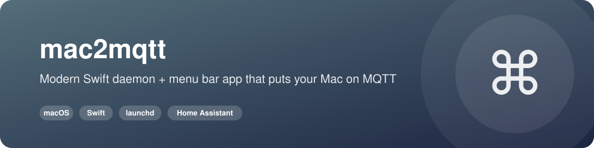
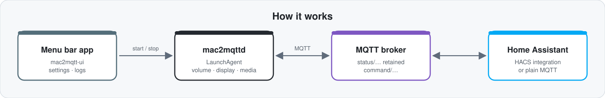
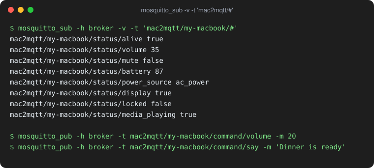
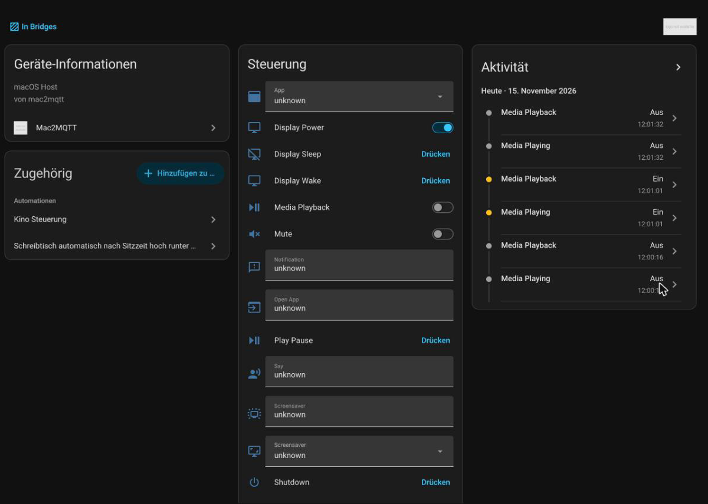

# mac2mqtt (`mac2mqttd` + `mac2mqtt-ui`)

[English](README.md) · **Deutsch**




Modernisierte Swift-Version von [`mac2mqtt`](https://github.com/bessarabov/mac2mqtt) für aktuelle macOS-Versionen. Der Mac meldet seinen Zustand per MQTT und nimmt Befehle an – ideal für Home Assistant.

- `mac2mqttd` = Dienst (MQTT + macOS-Steuerung)
- `mac2mqtt-ui` = Menüleisten-App (Start/Stopp/Neustart, Einstellungen, Logs)



## Schnellstart

1. Neueste Version unter [Releases](https://github.com/dr-apple/mac2mqtt/releases) laden oder selbst bauen (siehe unten) und `Mac2MQTT.app` nach „Programme“ ziehen.
2. App starten → Menüleisten-Symbol → **Settings**: MQTT-Host, Benutzer, Passwort und Computername eintragen.
3. **Start Service** – fertig. In MQTT erscheinen die Topics unter `mac2mqtt/<computerName>/…`.
4. In Home Assistant die Integration [Mac2MQTT für Home Assistant](https://github.com/dr-apple/mac2mqtt-for-home-assistant) installieren – dann gibt es pro Mac ein Gerät mit allen Entitäten.



## Konfiguration (`~/mac2mqtt/mac2mqtt.yaml`)

```yaml
computerName: "my-macbook"

mqtt:
  host: "192.168.1.10"
  port: 1883
  username: "mac2mqtt"
  password: "geheim"
  useTLS: false
  keepAliveSeconds: 30

topics:
  base: "mac2mqtt"

intervals:
  volumeSeconds: 2
  batterySeconds: 60
  displaySeconds: 5
  mediaSeconds: 1
```

Die Menüleisten-App schreibt diese Datei für dich; von Hand bearbeiten ist nur nötig, wenn du ohne App arbeitest.




*Echter Screenshot aus einer Home-Assistant-Installation (persönliche Daten ersetzt).*

## Funktionen

- Publiziert:
  - `status/alive`
  - `status/volume`
  - `status/mute`
  - `status/battery` (nur bei Macs mit internem Akku)
  - `status/power_source` (`ac_power` oder `battery`, nur bei Macs mit internem Akku)
  - `status/display` (`true` = Monitor an, `false` = Monitor aus)
  - `status/display_changed_at` (ISO-8601-Zeitstempel des letzten Monitor-Statuswechsels)
  - `status/locked` (`true` = Benutzer-Session ist gesperrt)
  - `status/media_playing` (`true` = Wiedergabe läuft, `false` = pausiert/gestoppt)
- Reagiert auf:
  - `command/volume`
  - `command/mute`
  - `command/sleep`
  - `command/shutdown`
  - `command/displaysleep`
  - `command/displaywake`
  - `command/display` (`sleep` oder `wake`)
  - `command/say` (Payload wird per macOS-Sprachausgabe vorgelesen; laufende Wiedergabe und Mute werden vorher pausiert/geändert und danach wiederhergestellt)
  - `command/notification` (Payload als Text oder JSON: `{"title":"Titel","message":"Text"}`; erscheint immer als Vordergrund-Dialog)
  - `command/screensaver` (Name eines nachinstallierten `.saver`)
  - `command/app` (App per Payload als Name/Pfad/Bundle-ID starten oder aktivieren)
  - `command/media_playback` (`play`, `pause` oder `toggle`)
  - `command/play_pause` (Alias für `toggle`)

Damit kannst du z.B. unter `<base>/<computerName>/status/display` sehen, ob mindestens ein angeschlossener Monitor aktiv ist, und unter `<base>/<computerName>/status/display_changed_at`, wann dieser Zustand zuletzt gewechselt hat.
Auf Macs ohne internen Akku werden `status/battery` und `status/power_source` nicht veröffentlicht; vorhandene retained Werte werden einmal gelöscht.
Apps können per Payload als Name (`Safari`), Bundle-ID (`com.apple.Safari`), Pfad (`/Applications/Safari.app`) oder JSON (`{"name":"Safari"}`) gestartet bzw. aktiviert werden.
Der Media-Status hat ein eigenes Polling-Intervall (`intervals.mediaSeconds`, Standard: `1`), damit Play/Pause schneller erkannt wird als Display- oder Battery-Status.

Topic-Schema:

`<base>/<computerName>/status/...` und `<base>/<computerName>/command/...`

## Einfach als .app (Drag & Drop)

Der einfachste Weg:

```bash
cd mac2mqtt
./build-app.sh
```

Danach liegt die App hier:

`dist/Mac2MQTT.app`

Die App dann einfach nach `Programme` ziehen.
Das Finder-/Remote-Symbol wird dabei automatisch als App-Icon gesetzt.

Beim ersten `Start Service` in der Menu-Bar macht die App alles selbst:

- installiert `mac2mqttd` nach `~/mac2mqtt/`
- legt `~/mac2mqtt/mac2mqtt.yaml` an (falls nicht vorhanden)
- erzeugt und startet den `launchd` LaunchAgent

## Build (Entwicklung)

```bash
cd mac2mqtt
swift build -c release
```

Binaries liegen danach unter:

- `./.build/release/mac2mqttd`
- `./.build/release/mac2mqtt-ui`

## Setup

1. Arbeitsordner anlegen:

```bash
mkdir -p ~/mac2mqtt
```

2. Daemon und Config kopieren:

```bash
cp ./.build/release/mac2mqttd ~/mac2mqtt/
cp ./mac2mqtt.yaml.example ~/mac2mqtt/mac2mqtt.yaml
chmod +x ~/mac2mqtt/mac2mqttd
```

3. `mac2mqtt.yaml` anpassen.

## Als Daemon starten (launchd)

Hinweis: Fuer User-Hintergrunddienste ist `LaunchAgents` der moderne und sichere Weg.

```bash
cp ./com.example.mac2mqttd.plist ~/Library/LaunchAgents/com.example.mac2mqttd.plist
```

Dann in der plist `USERNAME` ersetzen und laden:

```bash
launchctl bootstrap gui/$(id -u) ~/Library/LaunchAgents/com.example.mac2mqttd.plist
launchctl enable gui/$(id -u)/com.example.mac2mqttd
launchctl kickstart -k gui/$(id -u)/com.example.mac2mqttd
```

Stoppen:

```bash
launchctl bootout gui/$(id -u)/com.example.mac2mqttd
```

## Testlauf ohne launchd

```bash
~/mac2mqtt/mac2mqttd --config ~/mac2mqtt/mac2mqtt.yaml
```

## Menu-Bar App starten (ohne Bundle)

Die UI verwaltet `launchd` für dich und schreibt Config/Plist automatisch an die richtigen Stellen.

```bash
cd mac2mqtt
./.build/release/mac2mqtt-ui
```

Dann in der Menu-Bar:

- `Settings` für MQTT-Host, Topics und Poll-Intervalle
- `Start Service` / `Stop Service` / `Restart Service`
- `Logs` für stdout/stderr vom Daemon

## Optional: UI als .app Bundle bauen

Wenn du die UI als klickbare App haben willst:

```bash
mkdir -p Mac2MQTTUI.app/Contents/MacOS
cp ./.build/release/mac2mqtt-ui Mac2MQTTUI.app/Contents/MacOS/mac2mqtt-ui
cat > Mac2MQTTUI.app/Contents/Info.plist << 'EOF'
<?xml version="1.0" encoding="UTF-8"?>
<!DOCTYPE plist PUBLIC "-//Apple//DTD PLIST 1.0//EN" "http://www.apple.com/DTDs/PropertyList-1.0.dtd">
<plist version="1.0">
<dict>
  <key>CFBundleExecutable</key>
  <string>mac2mqtt-ui</string>
  <key>CFBundleIdentifier</key>
  <string>com.example.mac2mqtt-ui</string>
  <key>CFBundleName</key>
  <string>Mac2MQTTUI</string>
  <key>CFBundlePackageType</key>
  <string>APPL</string>
  <key>LSUIElement</key>
  <true/>
</dict>
</plist>
EOF
open ./Mac2MQTTUI.app
```

## Home Assistant

Die MQTT-Topics sind bewusst kompatibel zur bisherigen `mac2mqtt`-Logik gehalten, damit bestehende Automationen weiter funktionieren. Am bequemsten geht es mit der HACS-Integration [mac2mqtt-for-home-assistant](https://github.com/dr-apple/mac2mqtt-for-home-assistant).

Ohne Integration, z. B. ein einfacher MQTT-Sensor:

```yaml
mqtt:
  binary_sensor:
    - name: MacBook gesperrt
      state_topic: mac2mqtt/my-macbook/status/locked
      payload_on: "true"
      payload_off: "false"
```

Und ein Befehl aus einer Automation:

```yaml
action: mqtt.publish
data:
  topic: mac2mqtt/my-macbook/command/notification
  payload: '{"title":"Haustür","message":"Es hat geklingelt"}'
```

## Fehlersuche

| Problem | Lösung |
|---|---|
| Keine Topics im Broker | In der Menüleiste **Logs** öffnen – meist falscher Host oder falsche Zugangsdaten. |
| Lautstärke/Medien reagieren nicht | macOS fragt beim ersten Mal nach Automations-/Bedienungshilfen-Rechten – zulassen. |
| Dienst startet nach Neustart nicht | `launchctl print gui/$(id -u)/com.example.mac2mqttd` prüfen bzw. in der App erneut **Start Service**. |

## Lizenz

Siehe [LICENSE](LICENSE).
