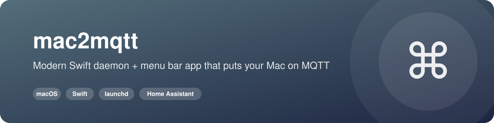
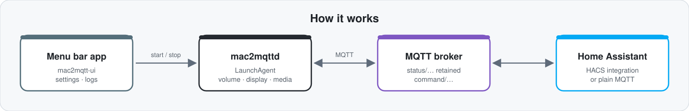
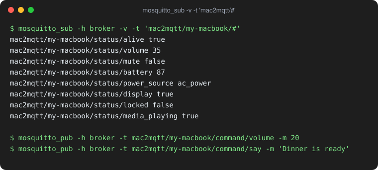
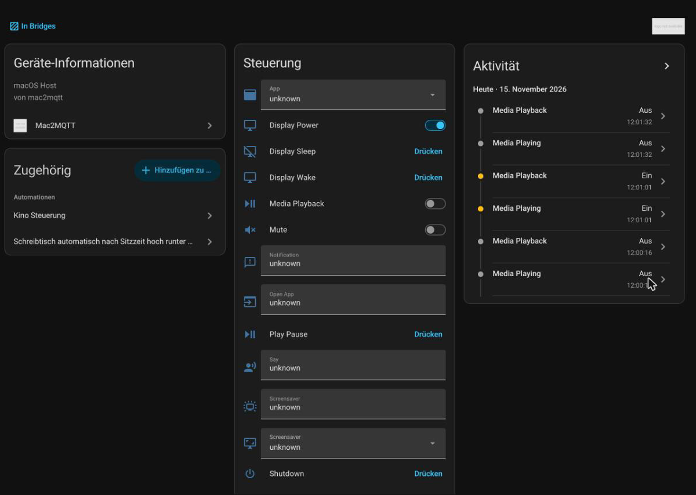

# mac2mqtt (`mac2mqttd` + `mac2mqtt-ui`)

**English** · [Deutsch](README.de.md)




A modernised Swift version of [`mac2mqtt`](https://github.com/bessarabov/mac2mqtt) for current macOS versions. Your Mac reports its state via MQTT and accepts commands – a perfect fit for Home Assistant.

- `mac2mqttd` = daemon (MQTT + macOS control)
- `mac2mqtt-ui` = menu bar app (start/stop/restart, settings, logs)



## Quick start

1. Download the latest version from [Releases](https://github.com/dr-apple/mac2mqtt/releases) or build it yourself (see below) and drag `Mac2MQTT.app` to *Applications*.
2. Launch it → menu bar icon → **Settings**: enter MQTT host, user, password and computer name.
3. **Start Service** – done. The topics appear in MQTT under `mac2mqtt/<computerName>/…`.
4. In Home Assistant install the [Mac2MQTT for Home Assistant](https://github.com/dr-apple/mac2mqtt-for-home-assisatant) integration – you get one device per Mac with all entities.





*Real screenshot from a Home Assistant installation (German UI, personal data replaced).*

## Features

Publishes:

- `status/alive`
- `status/volume`
- `status/mute`
- `status/battery` (only on Macs with an internal battery)
- `status/power_source` (`ac_power` or `battery`, only on Macs with an internal battery)
- `status/display` (`true` = monitor on, `false` = monitor off)
- `status/display_changed_at` (ISO-8601 timestamp of the last monitor state change)
- `status/locked` (`true` = user session is locked)
- `status/media_playing` (`true` = playing, `false` = paused/stopped)

Reacts to:

- `command/volume`
- `command/mute`
- `command/sleep`
- `command/shutdown`
- `command/displaysleep`
- `command/displaywake`
- `command/display` (`sleep` or `wake`)
- `command/say` (payload is spoken with macOS text-to-speech; playback and mute are paused/changed before and restored afterwards)
- `command/notification` (payload as text or JSON: `{"title":"Title","message":"Text"}`; always shown as a foreground dialog)
- `command/screensaver` (name of an installed `.saver`)
- `command/app` (launch or activate an app by name/path/bundle ID)
- `command/media_playback` (`play`, `pause` or `toggle`)
- `command/play_pause` (alias for `toggle`)

For example, `<base>/<computerName>/status/display` tells you whether at least one connected monitor is active, and `<base>/<computerName>/status/display_changed_at` when that last changed.
On Macs without an internal battery, `status/battery` and `status/power_source` are not published; existing retained values are cleared once.
Apps can be launched/activated by name (`Safari`), bundle ID (`com.apple.Safari`), path (`/Applications/Safari.app`) or JSON (`{"name":"Safari"}`).
Media state has its own polling interval (`intervals.mediaSeconds`, default `1`) so play/pause is detected faster than display or battery state.

Topic scheme: `<base>/<computerName>/status/...` and `<base>/<computerName>/command/...`

## Configuration (`~/mac2mqtt/mac2mqtt.yaml`)

```yaml
computerName: "my-macbook"

mqtt:
  host: "192.168.1.10"
  port: 1883
  username: "mac2mqtt"
  password: "secret"
  useTLS: false
  keepAliveSeconds: 30

topics:
  base: "mac2mqtt"

intervals:
  volumeSeconds: 2
  batterySeconds: 60
  displaySeconds: 5
  mediaSeconds: 1
```

The menu bar app writes this file for you; you only need to edit it by hand when running without the app.

## Build as a drag & drop .app

```bash
git clone https://github.com/dr-apple/mac2mqtt
cd mac2mqtt
./build-app.sh
```

The app is then at `dist/Mac2MQTT.app` – drag it to *Applications*. The icon is set automatically.

On the first **Start Service** in the menu bar the app does everything itself:

- installs `mac2mqttd` to `~/mac2mqtt/`
- creates `~/mac2mqtt/mac2mqtt.yaml` (if missing)
- creates and starts the `launchd` LaunchAgent

## Build (development)

```bash
swift build -c release
```

Binaries are then in `./.build/release/mac2mqttd` and `./.build/release/mac2mqtt-ui`.

## Manual setup without the app

1. Create a working folder: `mkdir -p ~/mac2mqtt`
2. Copy daemon and config:

   ```bash
   cp ./.build/release/mac2mqttd ~/mac2mqtt/
   cp ./mac2mqtt.yaml.example ~/mac2mqtt/mac2mqtt.yaml
   chmod +x ~/mac2mqtt/mac2mqttd
   ```

3. Edit `mac2mqtt.yaml`.

### Run as a daemon (launchd)

For per-user background services, a `LaunchAgent` is the modern and safe way.

```bash
cp ./com.example.mac2mqttd.plist ~/Library/LaunchAgents/com.example.mac2mqttd.plist
```

Replace `USERNAME` in the plist, then load it:

```bash
launchctl bootstrap gui/$(id -u) ~/Library/LaunchAgents/com.example.mac2mqttd.plist
launchctl enable gui/$(id -u)/com.example.mac2mqttd
launchctl kickstart -k gui/$(id -u)/com.example.mac2mqttd
```

Stop:

```bash
launchctl bootout gui/$(id -u)/com.example.mac2mqttd
```

### Test run without launchd

```bash
~/mac2mqtt/mac2mqttd --config ~/mac2mqtt/mac2mqtt.yaml
```

### Menu bar app without a bundle

The UI manages `launchd` for you and writes config/plist to the right places.

```bash
./.build/release/mac2mqtt-ui
```

In the menu bar:

- `Settings` for MQTT host, topics and poll intervals
- `Start Service` / `Stop Service` / `Restart Service`
- `Logs` for the daemon's stdout/stderr

## Home Assistant

The MQTT topics are deliberately compatible with the original `mac2mqtt`, so existing automations keep working. The most convenient way is the HACS integration [mac2mqtt-for-home-assisatant](https://github.com/dr-apple/mac2mqtt-for-home-assisatant).

Without the integration, e.g. a plain MQTT sensor:

```yaml
mqtt:
  binary_sensor:
    - name: MacBook locked
      state_topic: mac2mqtt/my-macbook/status/locked
      payload_on: "true"
      payload_off: "false"
```

And a command from an automation:

```yaml
action: mqtt.publish
data:
  topic: mac2mqtt/my-macbook/command/notification
  payload: '{"title":"Front door","message":"Someone rang the bell"}'
```

## Troubleshooting

| Problem | Fix |
|---|---|
| No topics in the broker | Open **Logs** in the menu bar – usually a wrong host or credentials. |
| Volume/media don't react | macOS asks for Automation/Accessibility permissions the first time – allow them. |
| Service doesn't start after reboot | Check `launchctl print gui/$(id -u)/com.example.mac2mqttd` or press **Start Service** in the app again. |

## License

MIT – see [LICENSE](LICENSE).
